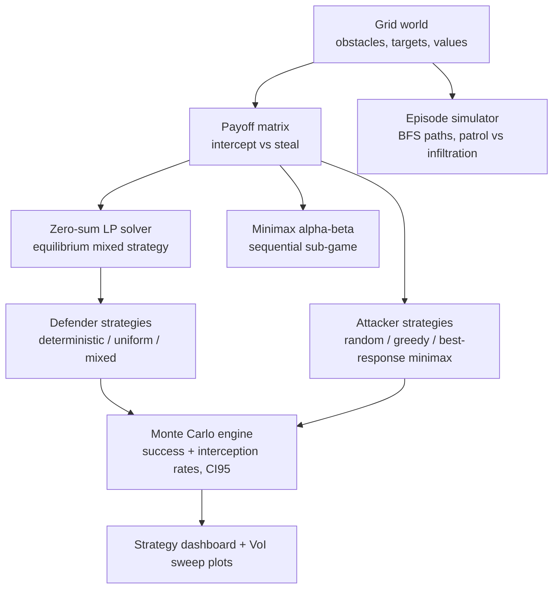

# NashGrid

Game-theoretic grid security simulator: a defender patrols protected targets on
an obstacle grid, an attacker infiltrates from the border. Includes exact
zero-sum mixed-strategy solving (LP), depth-limited minimax with alpha-beta,
Monte Carlo evaluation with confidence intervals, a Value-of-Information
sweep, and a strategy comparison dashboard.

**Status:** code complete, NOT YET EXECUTED. Run the verification below on your
machine; every number printed is measured by simulation at runtime.

## Architecture



## What is measured vs claimed

- Nothing is hardcoded: success rates, interception rates, payoffs, VoI curve —
  all computed from simulations of the strategies you select.
- The demo experiment suite measures: deterministic vs randomized vs
  equilibrium-mixed defenders against greedy and best-response attackers;
  grid sizes 6/8/10; target counts 2/3/4; attacker speeds 1/2.
- No claimed improvement percentage exists anywhere in the code or docs.

## Setup / Usage

```bash
cd nashgrid
python -m venv .venv && source .venv/bin/activate
pip install -r requirements.txt

python -m nashgrid --demo                 # full experiment suite + plots + JSON
python -m nashgrid --simulate --defender mixed --attacker bestresponse --episodes 200
python scripts/run_experiments.py         # same as --demo
python -m pytest tests -q
```

## Sample output format

```
=== NASHGRID DEMO (all numbers measured by this run) ===
matrix-game value (defender): <computed>
equilibrium defender strategy: [<computed>, ...]
Pairings (attacker success rate / interception rate):
  deterministic_vs_bestresponse   <computed> / <computed>
  ...
Value of Information:
  p_obs=0.0 attacker payoff <computed> (+/- <computed>)
  ...
```

## Verification

`pytest`

## Known limitations

- Abstracted grid world: an academic security-game model, not a deployment
  tool for physical security.
- Payoffs are site-based (attack one target per episode); richer multi-step
  games would need a different solver.
- LP solving uses scipy HiGHS; equilateral games verify against known
  equilibria (rock-paper-scissors, matching pennies) in tests.
